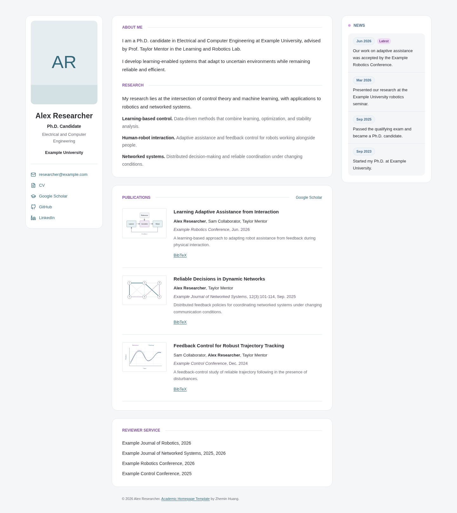

# Academic Homepage Template

基于 [Zhemin Huang 的个人主页](https://zheminhuang.github.io/) 整理的轻量学术主页模板。
使用纯 HTML/CSS，无需安装前端框架或执行构建。

[English](README.md) · [详细修改说明](docs/CUSTOMIZATION.md)



[查看手机端预览](docs/preview-mobile.png)

## 保留的设计

- 左侧个人资料，中间研究与论文，右侧 News 的三栏布局。
- About Me 与 Research 共用一个框；Publications 和 Reviewer Service 各有独立圆角框。
- News 全部展开，带日期和 Latest 标记。
- 论文缩略图完整显示，点击查看原图；示例 BibTeX 可直接下载。
- 手机与平板适配、网页版 CV、打印样式、键盘焦点及减少动态效果支持。
- 可选的数学符号点击效果，无统计脚本、外部字体或运行时依赖。

**示例中的姓名、学校、论文、期刊会议、审稿与获奖经历均为虚构。**
示意图不是实验结果。发布自己的主页前，请替换所有示例内容。
模板不含原作者的人像、NYU 校徽、真实论文或出版社 PDF。

## 快速部署

1. 仓库启用模板功能后，可点击 **Use this template**；也可以直接 Fork。
2. 修改 `index.html` 和 `cv/index.html` 中的姓名、联系方式和学术内容。
3. 替换 `assets/images/` 下的头像及论文配图。
4. 在 **Settings > Pages** 中选择 **Deploy from a branch**，分支 `main`，目录 `/(root)`。

模板兼容 `用户名.github.io` 根站点和 `用户名.github.io/仓库名/` 项目站点。
资源路径已使用相对路径，不需要修改 base URL。
新增资源时请使用 `assets/...`，不要加开头的 `/`。
GitHub Pages 设置可参照[官方文档](https://docs.github.com/en/pages/getting-started-with-github-pages/configuring-a-publishing-source-for-your-github-pages-site)。

## 本地查看

可以直接打开 `index.html`。为保证 SVG 图标和下载行为一致，推荐在模板目录执行：

```bash
python3 -m http.server 8000 --bind 127.0.0.1
```

浏览器访问 `http://127.0.0.1:8000/`。端口已占用时换一个即可。

## 修改入口

| 修改内容 | 文件 |
| --- | --- |
| 个人信息、研究、News、论文和 Reviewer Service | `index.html` |
| 简历，以及与主页重复的审稿列表 | `cv/index.html` |
| 配色、圆角、头像缩放、响应式布局 | `styles.css` |
| CV 与打印样式 | `cv/cv.css` |
| 头像、论文图 | `assets/images/` |
| BibTeX | `assets/bib/` |
| 点击效果 | `assets/js/click-effects.js` |

主页和 CV 不自动同步；共同的信息需要两处一起更新。
论文 PDF、按钮、News 日期和搜索引擎信息的修改示例见[自定义指南](docs/CUSTOMIZATION.md)。

## 检查

```bash
python3 scripts/check.py
```

无需第三方 Python 包。检查包含本地链接、图片属性、SVG、页面锚点以及相对路径。
GitHub Actions 也会自动运行。外部链接的内容、论文事实和版权需要自行核对。
修改后请同时查看桌面和手机布局。

## 许可

代码及自制示例图使用 [MIT License](LICENSE)。再分发时请保留许可证，网页页脚署名可自行选择保留。
图标的独立许可证见 [assets/icons/LICENSE.txt](assets/icons/LICENSE.txt)。
设计参考及素材说明见 [THIRD_PARTY_NOTICES.md](THIRD_PARTY_NOTICES.md)。
你添加的人像、论文与学校标志不自动适用模板的 MIT 许可，请确认相应使用权限。
